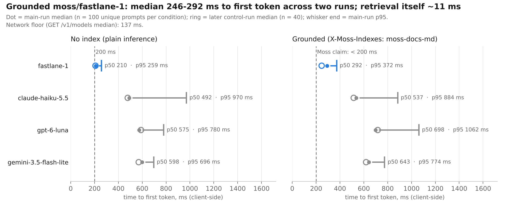
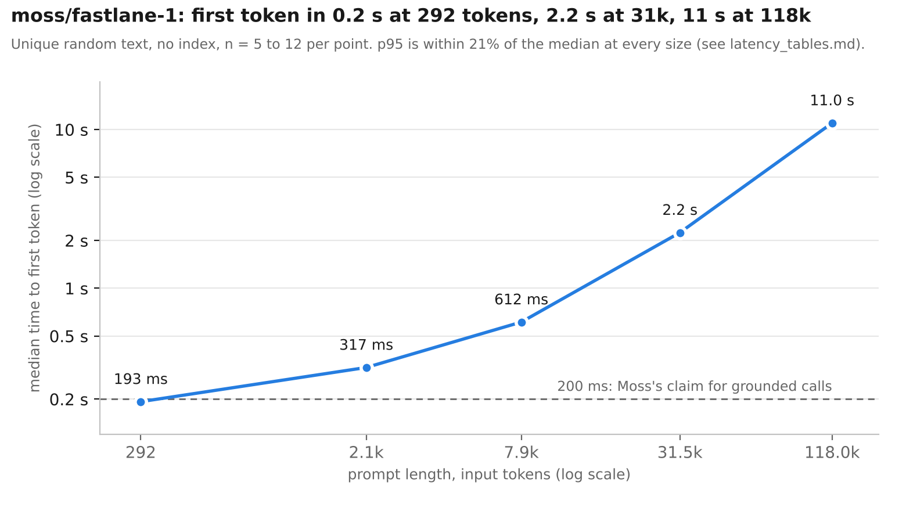

# Moss Inference: results

All numbers here trace back to the logs in `../logs/`. Summary tables come from `scripts/analyze_latency.py`, `scripts/grounding_accuracy.py`, and `scripts/summarize_research.py`, and `scripts/build_results.py` drops them into this document.

## TL;DR

1. From a remote test machine, `moss/fastlane-1` hit first token in 210 ms median plain and 246-292 ms grounded across two runs (about 2-3x faster ungrounded and 1.8-2.4x faster grounded than vendor models on the same endpoint at 490-700 ms). Subtracting my 137 ms network baseline leaves server time plausibly under Moss's 200 ms target, though there's no server-side TTFT header to check it directly.
2. Attaching a clean index lifted factual accuracy from 0% to 85% on fastlane (83% on Claude Haiku 5.5) over 23 questions x 2 trials. Whenever a model didn't know, it replied `"I do not know"` instead of guessing, and all 6 unanswerable controls were declined.
3. TTFT grows quickly with prompt length: 0.2 s at 300 tokens, 0.6 s at 8k, 2.2 s at 31k, and 11 s at 118k. Prefix caching cuts repeated prefixes right back down (2.2 s to 0.27 s).
4. Moss runs a fast reply cache with no headers indicating hits, which threw off my very first benchmark until I noticed repeated identical prompts were hitting the cache instead of the model. Cache keys respect request parameters and grounding headers, expire alongside index updates, and populate asynchronously on vendor models.
5. Index building took the most troubleshooting. The crawler only pulled 1 of 25 allowed pages and indexed 45% hydration-code junk, projects cap out at 3 indexes, quota errors overload HTTP 429, newly `"completed"` index updates took up to ~56 s before showing up in search, and the first query on a brand-new index spent ~0.8 s loading it.
6. Across 10 graded Tasks API runs (two task variants across three tiers plus repeats), content scored 30/30 (easy) and 24/24 (hard) with zero fabricated rows for the fake vendor. `moss-fast` cost ~10x less for the same accuracy, though 1 of its 6 runs failed `output_schema` checks while still ending as `completed`.
7. Docs vs reality: a handful of minor doc mismatches turned up (section 7), along with plan limits sharing HTTP 429 with rate limits.

## 1. A correction to my own first latency test

My first latency run (`logs/inference_ttft.jsonl`) sent the same prompt 5 times to each model and came back with ~90 ms TTFT for everyone, including GPT-6 Luna and Claude Haiku 5.5. Those numbers didn't reflect model speed at all. Moss's pricing docs mention a reply cache that serves repeated prompts without running the model and bills 0 input tokens, and the raw log shows that exact signature: slow on the first call (`204 / 795 / 1291 ms`), then flat around ~90 ms on repeats where `total == ttft` (the full reply came back in one shot).

After that, I appended a random nonce to every prompt so calls stayed unique, flagged anything with `input_tokens == 0` as a cache hit, and benchmarked cache hits on their own in section 4. The original log is still in the repo so that early mistake stays visible.

## 2. Method

Each worker used a keep-alive `requests.Session` streaming `POST /v1/responses` from a remote Linux host behind an HTTPS proxy, timed with `time.perf_counter()` right before sending the request. I took TTFT at the first `response.output_text.delta` event. Because the server waits until the first token is ready before sending HTTP headers, response headers arrived within 2.3 ms median of the first delta (p95 5.2 ms), so a client can't separate request acceptance from first-token time. To measure the network baseline along the exact same route, I timed keep-alive `GET /v1/models` calls (137 ms median) and subtracted that to estimate server latency.

The prompt suite had 40 questions about Moss Inference, each given a unique 6-character nonce, `max_output_tokens = 80`, and identical `instructions`. Grounded calls added `X-Moss-Indexes: moss-docs-md`. I set `reasoning.effort = none` for every model except Gemini 3.5 Flash-Lite, which rejects that parameter (section 7); without it, GPT-6 Luna burns the whole 80-token cap on hidden reasoning and returns empty text.

The main study sent 800 interleaved calls (4 models x plain/grounded x n=100) so time-of-day drift hit every condition evenly. Because the research tasks in section 8 overlapped that window, I ran an isolated control run (n=40 per condition) afterward. Percentiles use linear interpolation with 2,000-resample 95% bootstrap CIs on the median; at n=100, p95 gets noisy and p99 sits close to the max, so treat tail numbers loosely. Grounding used `moss-docs-md`, a 129-chunk index built from 14 raw `.md` pages on `docs.moss.dev` (section 6 explains why I skipped HTML). Given its small size, it doesn't speak to retrieval at scale. Total spend for the latency tests was ~$0.82 at published token rates plus $0.50 per 1,000 retrievals.

## 3. Latency

| connection | n | p50 ms | p95 ms | max ms |
|---|---|---|---|---|
| keep-alive | 60 | 137 | 165 | 240 |
| new connection each time | 20 | 137 | 177 | 438 |

| condition | n ok | err | cache hits | TTFT p50 (95% CI) | p90 | p95 | p99 | max | p50 minus floor | retrieve ms p50 / p95 | input tokens (median) |
|---|---|---|---|---|---|---|---|---|---|---|---|
| anthropic/claude-haiku-5.5 / grounded | 100 | 0 | 0 | 537 (523-557) | 834 | 884 | 1065 | 1092 | 401 | 11 / 15 | 1202 |
| google/gemini-3.5-flash-lite / grounded | 100 | 0 | 0 | 643 (628-659) | 745 | 774 | 839 | 1050 | 506 | 11 / 14 | 882 |
| moss/fastlane-1 / grounded | 100 | 0 | 0 | 292 (286-302) | 355 | 372 | 586 | 692 | 155 | 11 / 14 | 1083 |
| openai/gpt-6-luna / grounded | 100 | 0 | 0 | 698 (673-723) | 950 | 1062 | 1919 | 2005 | 561 | 12 / 15 | 834 |
| anthropic/claude-haiku-5.5 / plain | 100 | 0 | 0 | 492 (463-527) | 846 | 970 | 1177 | 1309 | 355 | - | 73 |
| google/gemini-3.5-flash-lite / plain | 100 | 0 | 0 | 598 (585-615) | 671 | 696 | 752 | 888 | 461 | - | 54 |
| moss/fastlane-1 / plain | 100 | 0 | 0 | 210 (207-215) | 243 | 259 | 295 | 459 | 73 | - | 145 |
| openai/gpt-6-luna / plain | 100 | 0 | 0 | 575 (566-590) | 717 | 780 | 920 | 1113 | 438 | - | 57 |

### Cost of grounding (median TTFT grounded minus plain, with 95% bootstrap CI)

| model | delta ms | 95% CI |
|---|---|---|
| anthropic/claude-haiku-5.5 | +46 | +9 to +81 |
| google/gemini-3.5-flash-lite | +45 | +25 to +66 |
| moss/fastlane-1 | +82 | +75 to +93 |
| openai/gpt-6-luna | +124 | +91 to +149 |

Plain `moss/fastlane-1` hit first token in 210 ms median client-side (95% CI 207-215 ms; p95 259 ms, p99 295 ms). Subtracting the 137 ms floor leaves roughly 73 ms on the server. Grounded fastlane landed at 292 ms median in the main run and 246 ms in the control run (plus 252 ms and 242 ms in the concurrency tests), while plain fastlane stayed flat (210 vs 208 ms). I couldn't isolate that ~+-25 ms run-to-run swing, which puts the server share around 110-155 ms. That makes Moss's "<200 ms" claim plausible, though you can't confirm it strictly from outside.

Most of the +82 ms grounding gap on fastlane (95% CI +75 to +93 ms) comes from prefilling ~1,083 input tokens instead of ~145; retrieval itself only took 11 ms median (14 ms p95 from `X-Moss-Retrieve-Ms` on 129 chunks). Vendor models added +45 to +124 ms when grounded. In the main run, fastlane reached first token 282-388 ms earlier than vendor models ungrounded and 245-406 ms earlier grounded, with a much tighter tail: fastlane grounded p99 was 586 ms (max 692 ms), whereas vendor models stretched to 1-2 s at p99 (1,919 ms on Luna). That tail matters a lot for voice agents.

| target tokens | actual input tokens (median) | n | TTFT p50 | p95 | max |
|---|---|---|---|---|---|
| 200 | 292 | 12 | 193 | 209 | 219 |
| 2000 | 2068 | 12 | 317 | 384 | 399 |
| 8000 | 7945 | 12 | 612 | 631 | 632 |
| 32000 | 31480 | 10 | 2242 | 2283 | 2302 |
| 120000 | 117964 | 5 | 10994 | 11030 | 11034 |

Shared 32k-token prefix, 10 different questions: first call TTFT 2246 ms; calls 2-10 median 269 ms, median cached tokens 31200.0.

Even though the docs suggest `moss/fastlane-1` whenever prompts and retrieved chunks fit inside 262,144 tokens, TTFT climbs linearly with input size (roughly 11-15k tokens/s prefill): 0.6 s at 8k tokens, 2.2 s at 31k, and 11 s at 118k. Under 200 ms only holds up to a few hundred or low thousands of tokens. Prefix caching does work well: reusing a 32k-token prefix with a new question cut TTFT from 2,246 ms down to 269 ms.

| workers | n ok | 429s | TTFT p50 | p95 | p99 | max | median in-flight at start |
|---|---|---|---|---|---|---|---|
| 1 | 60 | 0 | 252 | 354 | 482 | 622 | 1 |
| 3 | 60 | 0 | 242 | 331 | 385 | 387 | 1 |

Three overlapping workers at ~1.5 requests/s stayed under the documented limit with no latency drop or 429 errors.

| idle gap | what the client did first | GET /models ms | 1st query TTFT ms | 2nd query TTFT ms | 1st retrieve ms |
|---|---|---|---|---|---|
| 10s | query directly | - | 386 | 259 | 12.7 |
| 10s | GET /models, then query | 157 | 252 | 261 | 13.6 |
| 60s | query directly | - | 608 | 300 | 13.9 |
| 60s | GET /models, then query | 420 | 272 | 264 | 17.9 |
| 300s | query directly | - | 586 | 249 | 14.7 |
| 300s | GET /models, then query | 441 | 271 | 259 | 13.2 |

Retrieval stayed at 13-15 ms after up to 5 minutes idle, so neither the index nor the model looked cold. The catch is that the first call after a pause paid an extra +127 ms after 10 s, +308 ms after 60 s, and +337 ms after 300 s. Sending a lightweight `GET /v1/models` call first absorbed the 157-441 ms reconnect hit and brought the following query back to 252-272 ms. That looks like TCP/TLS reconnect overhead, which voice-agent docs ought to mention.

## 4. The reply cache

Each prompt was sent 3 times back-to-back. For moss/fastlane-1 some requests were rate-limited (429) because the experiment exceeded the documented 120/min and burst-10 limits; those are excluded from TTFT and counted here.

| model | requests | 429s | misses: n, TTFT p50 / p95 ms | hits: n, TTFT p50 / p95 ms | repeats that were hits |
|---|---|---|---|---|---|
| anthropic/claude-haiku-5.5 | 90 | 0 | 80, 483 / 1015 | 10, 141 / 172 | 17% (10/60) |
| moss/fastlane-1 | 90 | 31 | 30, 194 / 207 | 29, 144 / 184 | 71% (29/41) |

Cache hits return right around the network floor (144 ms vs 194 ms on fastlane; 141 ms vs 483 ms on Haiku) and report `input_tokens = 0`. Passing `X-Moss-Cache: off` bypasses the cache as documented. The 71% hit rate in the fastlane table above looks low only because 429s rejected the first call of several triples before anything got cached; in a clean dedicated check, 60 of 60 repeats hit.

Key-isolation tests (`logs/behavior/probe_run2.txt`) confirmed that changing `max_output_tokens`, `instructions`, or `text.format` produces a fresh reply, and `X-Moss-Indexes` / `X-Moss-Retrieve` are hashed into the key so ungrounded answers don't leak into grounded calls or vice versa.

Vendor models appear to populate the cache asynchronously. Immediate repeats hit anywhere from 17% to 83% of the time on Haiku (and 33% on GPT-6 Luna) with no steady pattern; polling every 0.5 s showed hits landing around ~0.7 s (0.6-2.7 s observed). Fastlane hit 60/60 right away regardless of delay, and `X-Moss-Box` stayed identical across requests, ruling out per-node routing differences (`logs/behavior/cachemodels.txt`, `cachebox.txt`, `cachedelay.txt`).

When updating an index, `addDocs` returned `completed` in 2.4-2.5 s, while new chunks took 55.1 and 55.7 s to become searchable in two clean probes (plus 2.8 and 16.5 s in two earlier runs; 3 of 5 landed around 54-56 s, pointing to roughly a 1-minute refresh cycle). Identical cached queries kept returning the old reply for 55.4 s and 56.1 s until the index updated, then switched straight to fresh uncached replies. An earlier check flagged this as a cache bug before I traced it to index-refresh lag (`logs/behavior/freshness.json`, `fresh_stdout.txt`). One quirk: cache hits report slightly different `output_tokens` counts than the miss they replay (19 vs 17 in one pair, 36 vs 48 earlier), which can skew usage metering.

## 5. Does grounding work?

I tested 23 factual questions whose exact answers sit in the docs (2 trials each), along with 3 unanswerable controls (pricing for a nonexistent model, a Tasks API rate limit, and an uptime SLA).

| configuration | factual accuracy | abstained on unanswerable | median TTFT ms | median retrieve ms | median input tokens |
|---|---|---|---|---|---|
| fastlane + clean index (moss-docs-md) | 39/46 (85%) | 6/6 | 263 | 12 | 1198 |
| fastlane, no index | 0/46 (0%) | 6/6 | 213 | 0 | 166 |
| fastlane + crawler-built index (moss-docs) | 0/46 (0%) | 6/6 | 281 | 13 | 1030 |
| claude-haiku-5.5 + clean index | 38/46 (83%) | 6/6 | 524 | 13 | 1353 |

With a clean index, fastlane scored 39/46 (85%) and Haiku scored 38/46 (83%), compared with 0/46 for ungrounded fastlane. Every single missed question returned `"I do not know"` instead of inventing a figure. All missed answers were actually in the index (pricing tables, `X-Moss-Cache`, default `max_runtime_seconds`), so failures came down to retrieval ranking on tables and exact header names. Right now the inference API doesn't expose top-k or keyword-weight knobs even though hybrid search exists in the SDKs. The crawler-built index scored 0/46 because it only ingested one page (section 6). At matching accuracy on this set, Haiku took ~260 ms longer to first token than fastlane (524 vs 263 ms median).

## 6. Building the index (the control plane)

Getting grounding working meant calling the index-management API (`service.usemoss.dev`) and its web crawler, which turned out to be the biggest time sink.

Pointed at `docs.moss.dev/docs/inference/overview` with `includePaths`, depth 2, and a 40-page cap, the crawler reported `lastPageCount = 1` and stored 62 chunks, 28 of which were raw Next.js/MDX hydration strings (`_jsx(_components.span, {style:{color:...`). Dropping `includePaths` or passing `**` produced the exact same 1-page crawl; starting from the docs homepage at depth 1 only pulled 2 pages (19 of 83 chunks framework clutter). Pointing the crawler straight at each page's raw `.md` URL (Mintlify serves them) gave clean chunks, at the cost of one web source per page (`logs/index_crawl_tests.json`, `logs/index_docs.json`).

Plan limits also share HTTP 429 with rate limits. Adding 13 pages triggered `429 USAGE_LIMIT_EXCEEDED` ("Concurrent crawl and parse job limit of 1 reached") on 11 of 13 first attempts, forcing me to serialise them (~20 s each). Later, creating another index hit `429 "Index limit exceeded (3/3)"`. Both messages explain the failure, though returning 429 `USAGE_LIMIT_EXCEEDED` makes hard quotas and concurrency caps look like throttling or empty credits.

Two timing surprises came up around readiness. Even though `addDocs` finishes in 2.4-2.5 s, new content took 55.1 and 55.7 s to show up in search during clean probes (with 2.8 s and 16.5 s in earlier ad-hoc checks), so "instant index updates" really has roughly a 1-minute propagation lag. Also, the very first query on a brand-new index (18.9 s after build completion) spent 815 ms retrieving and 1,245 ms to first token, while the next seven calls dropped to ~10 ms retrieval and 241-319 ms TTFT (two earlier unlogged runs hit 976 ms and 798 ms). In production, the first caller after creating an index eats that cold load (`logs/behavior/cold_index.json`).

## 7. Errors, limits and documentation

* Burst limits worked as documented: across 30 simultaneous calls, 10 passed and 20 got `429` with `Retry-After: 1` and `X-Ratelimit-Remaining-Requests: 0`, and waiting 1 s let requests through again (`logs/behavior/burst.json`).
* Sustained limits (120 requests/min, burst 10 on fastlane) matched too, with `x-ratelimit-*` headers decrementing on each call. In the cache run where I tripped the limit, the 429 body also printed the project ID (`Rate limit reached for project <id>: ...`).
* Requesting an unknown index returns `403 permission_error` ("outside this project") instead of 404, which makes an index-name typo read like an auth problem.
* Docs drift: the Overview page mentions an optional `indexes` body field, while the API throws `400 unsupported_parameter` if `indexes` is in the JSON body and only reads the `X-Moss-Indexes` header over raw HTTP (the SDKs map it).
* Passing `reasoning.effort = none` to Gemini 3.5 Flash-Lite returns a generic `400 "The model rejected the prompt: HTTP 400: Request contains an invalid argument."` without naming the field, unlike Moss's `unsupported_parameter` messages.
* GPT-6 Luna enables reasoning by default: with `max_output_tokens: 80`, it returned HTTP 200 with `status: incomplete` and empty text after burning all 80 tokens on reasoning. That matches OpenAI's API behaviour, though Moss users hit blank replies until they discover `reasoning.effort`.
* SSE formatting matched the docs: Responses streams omit `[DONE]` and stick to documented event types, while Chat Completions sends a final usage chunk with empty `choices` followed by `data: [DONE]`.

## 8. Tasks API: a research task

I put together a competitive-intelligence research task with verifiable ground truth in two versions and ran both across all three model tiers (`moss-fast`, `moss-balanced`, `moss-advanced`, effort `medium`).

The easy version checked 6 vendors (Pinecone, Qdrant, Weaviate, Chroma, Moss, and a fake "Zyphrelon Vector Cloud") and asked for each official Python SDK on PyPI plus its GitHub repo, latest stable version, release date, `requires_python`, repo slug, and GitHub "Latest" release tag. Built-in traps included the deprecated `pinecone-client` package vs `pinecone`, a Weaviate release from the day before, `usemoss/moss` marking its iOS SDK as "Latest" on GitHub instead of the Python SDK, and the fake vendor.

The hard version covered 9 vendors (adding Milvus, LanceDB, and Turbopuffer) on PyPI only: counting releases uploaded between 2026-08-29 and 2026-11-27 (Moss had 22, Chroma had 0), listing every counted version string so the count could be audited, and checking whether the latest stable release raised the minimum Python version compared with the previous stable one.

Ground truth came from PyPI's JSON API (pulled before and after each run so mid-run uploads wouldn't penalise an agent) and live GitHub Releases pages. Since an earlier smoke test with a mandatory string field forced an agent to write `"Could not verify..."` into a `phone` field, the `output_schema` allowed `null` values alongside an `unverified` list. Grading runs in `scripts/grade_research.py`, which scores factual accuracy separately from schema compliance (`verification.passed`).

| variant | tier | run | content score | schema valid | fake vendor handled | confident-but-wrong rows | steps | model calls | wall time | cost (USD) | input tokens (cached) | output tokens |
|---|---|---|---|---|---|---|---|---|---|---|---|---|
| easy | moss-fast | moss-fast_1 | 30/30 | yes | yes | 0 | 22 | 27 | 4.4 min | $0.037 | 570,458 (509,967) | 20,502 |
| easy | moss-balanced | moss-balanced_1 | 30/30 | yes | yes | 0 | 23 | 24 | 4.4 min | $0.340 | 736,690 (683,776) | 8,242 |
| easy | moss-advanced | moss-advanced_1 | 30/30 | yes | yes | 0 | 36 | 37 | 5.8 min | $0.540 | 1,575,289 (1,503,444) | 11,948 |
| hard | moss-fast | moss-fast-hard_1 | 24/24 | NO (20 problems) | yes | 0 | 41 | 64 | 10.0 min | $0.134 | 2,246,993 (1,843,540) | 60,558 |
| hard | moss-fast | moss-fast-hard_2 | 23/24 (+1 left null) | yes | yes | 0 | 19 | 26 | 4.1 min | $0.041 | 456,125 (397,935) | 29,888 |
| hard | moss-fast | moss-fast-hard_3 | 24/24 | yes | yes | 0 | 21 | 28 | 5.2 min | $0.043 | 624,419 (558,101) | 27,234 |
| hard | moss-balanced | moss-balanced-hard_1 | 24/24 | yes | yes | 0 | 30 | 31 | 5.0 min | $0.396 | 950,927 (901,228) | 11,513 |
| hard | moss-balanced | moss-balanced-hard_2 | 24/24 | yes | yes | 0 | 30 | 31 | 4.9 min | $0.410 | 939,014 (883,204) | 11,369 |
| hard | moss-advanced | moss-advanced-hard_1 | 24/24 | yes | yes | 0 | 30 | 31 | 4.9 min | $0.421 | 947,933 (894,220) | 12,693 |
| hard | moss-advanced | moss-advanced-hard_2 | 24/24 | yes | yes | 0 | 30 | 31 | 4.6 min | $0.409 | 1,033,271 (978,388) | 10,581 |

Total reported cost of these 10 runs: $2.77 (model + browser time; browser traffic is billed separately at $5/GB and is reported only hours later: not yet reported for any run).

With 1 to 3 runs per cell, treat these tier numbers as rough indications.

Answer quality stayed high everywhere: almost every run got full marks (`moss-fast-hard_2` left Pinecone's `requires_python_change` null and marked it `partial`), no tier fabricated data for Zyphrelon, and none made confident mistakes. Cost was the big difference: `moss-fast` ran at $0.037 (easy) and $0.041-0.043 (hard, 2 of 3 runs) vs $0.34 / $0.40-0.41 on `moss-balanced` and $0.54 / $0.41-0.42 on `moss-advanced` (about 10x cheaper at matching accuracy). On the hard suite, `balanced` and `advanced` looked almost identical (30 steps, ~5 min, ~$0.41 in all four runs).

Where the cheap tier struggled was schema reliability. `moss-fast-hard_1` ran 41 steps (10 min, $0.13) and returned invalid JSON against its schema (20 `verification` errors including renamed keys like `package` and `window_release_count`, plus `unverified: null` instead of a list), yet the job still ended with `status: completed`. Its two repeats ran normally (19-21 steps, 4-5 min, $0.04, valid schema). Across all runs, 1 of 6 `moss-fast` runs failed schema validation compared with 0 of 7 on the pricier tiers. If a script only checks `status`, it will quietly accept broken JSON; you have to inspect `verification.passed`. Also note that the $2.77 total excludes browser traffic ($5/GB), which bills hours later (`traffic_usd` was still `null` across all 10 runs roughly an hour after completion).

The agents' `notes` fields surfaced a few helpful surprises:

* On the fake vendor, every run returned `status: not_found` with `null` fields and reasoning (one screenshot showed the agent's `site:pypi.org "Zyphrelon"` search returning "No results found").
* Agents called out messy real-world cases on their own: flagging `usemoss/moss`'s "Latest" tag (`v0.17.0`) as the iOS SDK, noticing PyPI showing Nov 2 local time vs Nov 3 UTC for Pinecone, and catching Milvus's parallel 2.6.x and 3.x tracks (making "previous stable" `3.0.2` by semver -> `unchanged`, or `2.6.18` by upload date -> `raised`; 3 of 7 hard runs picked upload date and 4 picked semver). Real outputs forced four fixes in my grader (stripping `"Python"` from `requires_python`, matching renamed keys, accepting both Milvus readings, and not crediting `null` answers), with all raw `final.json` outputs saved for regrading.
* When Weaviate's PyPI page threw a challenge, one agent switched to PyPI's JSON API and noted why. On `balanced` and `advanced`, agents also reported solving a PyPI "human check" / CAPTCHA; I didn't ask for that and couldn't verify how it happened from the sampled screenshots, so Moss should document whether browser agents are allowed to pass those checks.
* Agents also stated clearly what they hadn't proven, e.g., `"These checks do not prove that the vendor or an SDK under an unrelated name does not exist."`

Earlier smoke checks (`logs/tasks_*.txt`, `scripts/tasks_tests.py`) confirmed clean validation messages, exact `Idempotency-Key` behaviour (identical bodies replay with `Idempotent-Replayed: true`, mismatched bodies return 422), and quick cancellation (`cancelled` at $0.0004). Rapid-firing 22 creates all returned 202, leaving the documented 20-queued 429 limit inconclusive since tasks started running right away. In earlier schema tests, an impossible goal with a required string let an agent stick `"Could not verify..."` in the field with `verification.passed: true`, whereas a missing `title` returned `null` with `verification.passed: false` even though the task status still closed as `completed`.

## 9. What I did not test

* Anything inside Moss's own infrastructure beyond reading `X-Moss-Retrieve-Ms`.
* Other regions, times of day, accounts, or sustained traffic past documented limits (other than the burst check).
* Voice workloads (audio/barge-in), `moss_search` and MCP tools, bring-your-own-key, client SDKs, or retrieval on large indexes.
* Long-running Tasks jobs, file outputs, authenticated pages, page-based prompt injection, or larger sample sizes per tier cell.
* Deeper coverage of the portal UI.

## 10. What I would improve first

1. Expose server-side TTFT (`Server-Timing` or `X-Moss-Ttft-Ms`, like `X-Moss-Retrieve-Ms`) plus a prompt-length latency table so customers can actually verify the "<200 ms" target.
2. Document the reply cache (keys, TTL, invalidation behaviour), add a cache hit/miss header, and fold the index version into the cache key.
3. Wait until index updates are actually searchable before marking builds `completed`, or return a `searchable_at` / index version field.
4. Fix the web crawler on Mintlify-style sites (follow links, prefer `.md`/`llms.txt`, strip framework hydration markup, and report crawled/skipped pages), accept URL lists, and stop using HTTP 429 for index caps and concurrency limits.
5. Add retrieval tuning parameters (`top_k`, hybrid keyword weight) to the inference API; 15% of misses were exact-token queries like header names.
6. Document how to keep HTTP connections warm and what reconnect cost hits after idle periods.
7. Enforce `output_schema` in the Tasks API (retry verification failures or add a partial/failed end state), return step logs alongside screenshots, bill browser traffic sooner, and clarify policy on human-check challenges.
8. Clean up small doc gaps: `indexes` header vs body field, model reasoning defaults, and Gemini's vague 400 error.

## 11. Reproduce

See `../README.md`. Every benchmark and probe runs standalone from the CLI and writes raw logs.
